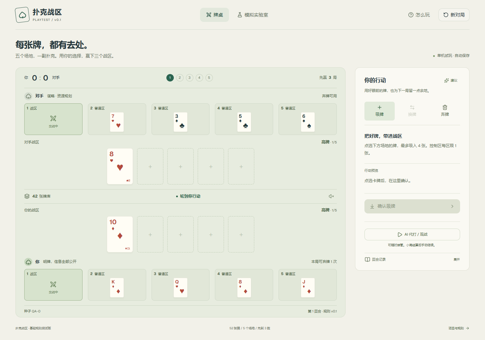

# 扑克战区

[开始试玩](https://tja688.github.io/poker-warzone/?rules=v0.3) · [经典](https://tja688.github.io/poker-warzone/?rules=v0.1) · [暗牌规则](docs/rules-v0.3.md) · [开发修改地图](docs/architecture.md)

默认是暗牌 v0.3。手牌和战区暗牌盖住，先赢三个战区。没有筹码和下注。页头可以换回经典 v0.1。



## 游玩

- 点场地牌选中，再确认吸牌；战区最多五张。
- 换牌先选目标牌型，界面预选一组合法组合。可切换组合，也可直接点牌调整换入、换出。
- 每局可弃一次普通牌；空位在自己下回合补满。
- 控制区可打开查看，每个控制区整场只可吸一张。
- 双方无合法行动时自动比牌。下一战区手动继续，先到三胜结束。

主牌桌占满一个窗口，支持手机横竖屏和平板；卡牌移动、弃牌回库、选中抬牌、结算说明和轻量音效提供反馈。右上角可静音、看规则、重新发牌。支持键盘、减少动态效果及本地自动续局。

## 开发

Node.js 24。安装依赖后启动：

```sh
npm ci
npm run dev
```

验证入口：

```sh
npm test
npm run build
npm run test:e2e
```

E2E 默认使用本机 Edge，CI 使用 `PLAYWRIGHT_CHANNEL=chromium`。测试截图写入 `.local/screenshots/`。

下一版从 [AGENTS.md](AGENTS.md) 和 [架构与修改地图](docs/architecture.md) 开始。规则引擎、AI 策略、选牌草稿、牌桌组件、表现反馈和模拟均有独立入口；UI 不复制规则判断。

## 研究工具

批量模拟移到[独立实验室](https://tja688.github.io/poker-warzone/?lab)，不占用游戏界面。仍支持 Worker 运行、三种 AI、停止及 CSV/JSON 导出。命令行与界面共用同一规则引擎：

```sh
npm run simulate -- --games 10000 --seed baseline-01 --a greedy --b greedy --out docs/simulation-baseline.json
```

AI 的依据与限制见 [AI 说明](docs/ai.md)，本轮验收见 [v0.2 报告](docs/playtest-v0.2.md)。[v0.1 报告](docs/playtest-report.md) 中的统计为当时实际模拟结果。

## 发布

推送 `main` 后 GitHub Actions 执行测试、构建并部署 Pages。构建产物使用相对资源路径。存档仍沿用原规则版本，已有有效对局可继续；未来不兼容规则的迁移方式见架构文档。
